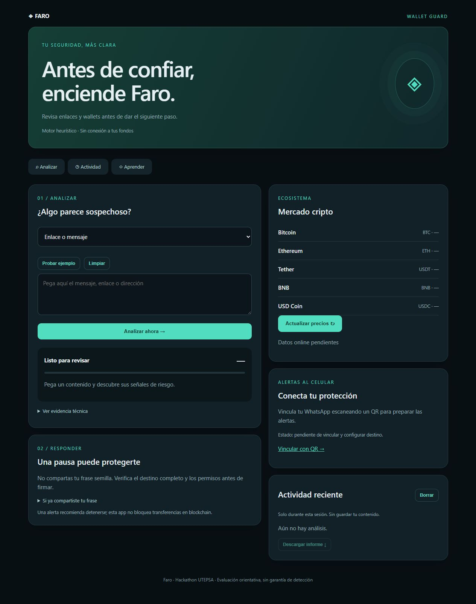
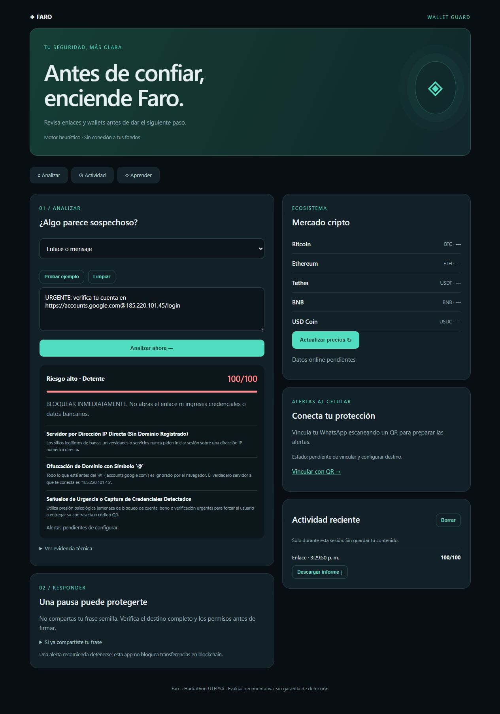
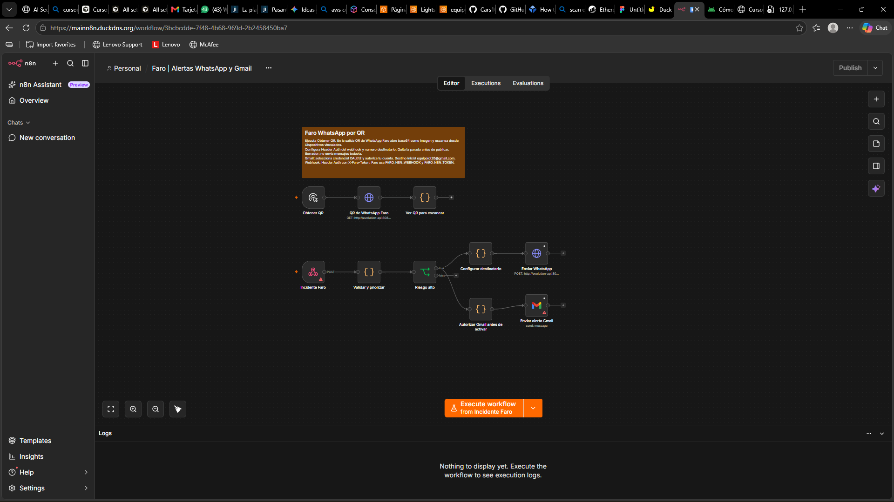
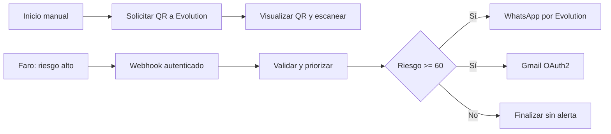

# UTEPSA · Faro

Aplicación de protección digital y criptomonedas desarrollada para el Hackathon UTEPSA. Ayuda a revisar mensajes, enlaces y destinos de wallet antes de abrir, compartir o firmar una operación.

## Capturas de la aplicación y del flujo

### Inicio de Faro


### Detección de phishing
Ejemplo de laboratorio con una URL que oculta el destino mediante `@`. La captura muestra el puntaje y la evidencia; no confirma el envío de notificaciones.



### Flujo WhatsApp y Gmail en n8n
Captura del flujo instalado en AWS, proporcionada durante el desarrollo. Incluye generación de QR, recepción de incidentes, priorización y ramas de WhatsApp/Gmail. Los avisos y pasos de configuración reflejan que las integraciones todavía están pendientes de activación. La nota de la captura conserva un destinatario anterior; el destino debe configurarse en el nodo Gmail.



## Público objetivo
Estudiantes, personas que empiezan a usar criptomonedas y usuarios de wallets que necesitan entender señales de phishing con lenguaje sencillo. También sirve como demostración educativa para equipos de soporte y seguridad.

## Qué hace
- Analiza enlaces y mensajes mediante reglas heurísticas: suplantación, dominios sospechosos, urgencia y trucos en URLs.
- Analiza contenido de QR y wallets, permisos ilimitados y diferencias respecto de una dirección de referencia.
- Muestra riesgo de 0 a 100, evidencia y recomendaciones.
- Guarda actividad únicamente durante la sesión y permite descargar un informe JSON.
- Consulta bajo demanda precios de BTC, ETH, USDT, BNB y USDC mediante CoinGecko.
- Prepara notificaciones de riesgo alto por n8n, WhatsApp y Gmail.
- Conserva una interfaz anterior y herramientas locales de auditoría Wi-Fi y escenarios simulados para demostración.

No es un agente LLM: el análisis actual usa reglas. No monitorea automáticamente todos los chats, no garantiza detectar fraudes y no bloquea transferencias blockchain. Los precios de mercado no constituyen una base de inteligencia de amenazas. Etherscan se propuso como ampliación; su API todavía no está integrada.

## Escanear QR desde el celular
Abre la app por HTTPS y pulsa **Escanear QR** para usar la cámara trasera, o **Subir QR** para elegir una foto. La lectura de imagen ocurre en el navegador; solo el contenido decodificado se manda al detector. No se abre el enlace automáticamente. El permiso de cámara debe concederse en el teléfono.

Se comprobó en la web la carga de una imagen QR de laboratorio y su análisis: 95/100. La cámara física todavía requiere prueba en el celular del usuario. Biblioteca: [Nimiq qr-scanner 1.4.2](https://github.com/nimiq/qr-scanner), licencia MIT incluida en static/vendor/LICENSE.

## Cómo funciona
1. El usuario pega un mensaje, enlace o contenido de QR/wallet.
2. Flask llama al motor de detección y devuelve indicadores y puntaje.
3. La interfaz presenta los hallazgos y las recomendaciones.
4. Si el riesgo es al menos 60 y están configuradas las variables del webhook, Faro envía únicamente puntaje y categoría a n8n.
5. n8n prioriza el evento y puede distribuir una alerta a WhatsApp y Gmail cuando estén autorizados y configurados.

La recepción HTTP del webhook no confirma entrega de mensajes. La app muestra esa diferencia.

## Ejecutar en Windows
Requiere Python y acceso a Internet para instalar dependencias y consultar servicios externos.

```powershell
python -m pip install -r requirements.txt
python app.py
```

Abre http://127.0.0.1:5060. También puedes usar `Iniciar-Faro.cmd` después de instalar dependencias. La interfaz anterior está en `/static/index.html`.

## Entorno y variables
La app lee variables del proceso; `.env.example` documenta sus nombres pero no se carga automáticamente.

| Variable | Uso |
| --- | --- |
| FARO_N8N_WEBHOOK | URL de producción del webhook de n8n |
| FARO_N8N_TOKEN | Secreto de Header Auth, cabecera X-Faro-Token |
| EVOLUTION_URL | URL interna de Evolution API v2 |
| EVOLUTION_API_KEY | Credencial del servicio, solo en servidor |
| EVOLUTION_INSTANCE | Instancia de WhatsApp, por defecto faro |
| PORT | Puerto local, por defecto 5060 |

```powershell
$env:FARO_N8N_WEBHOOK="https://TU-N8N/webhook/faro-whatsapp"
$env:FARO_N8N_TOKEN="TU_SECRETO"
python app.py
```

## Crear y configurar el servidor AWS

La [guía paso a paso del servidor AWS](docs/AWS-SERVIDOR.md) explica cómo lanzar EC2, configurar SSH y puertos, preparar Ubuntu/Docker, instalar Faro, publicar HTTPS con Caddy y conectar n8n, WhatsApp y Gmail. Distingue la infraestructura que ya existía de los cambios realizados durante este proyecto.

## Despliegue realizado en AWS
Fecha del trabajo: 31 de octubre de 2026. Servidor Ubuntu en AWS, con n8n y Evolution API existentes en Docker. No se creó infraestructura con Terraform ni un balanceador adicional.

- App pública: https://mainn8n.duckdns.org/faro/
- n8n: https://mainn8n.duckdns.org/
- Faro instalado en `/home/ubuntu/faro-app` dentro de un entorno virtual Python.
- Gunicorn ejecuta Flask mediante `faro.service`, con reinicio automático y arranque con el servidor.
- Caddy termina HTTPS y dirige `/faro/*` a Gunicorn; el resto continúa hacia n8n.
- Los archivos del servidor usan prefijo `/faro` para recursos y llamadas API. La versión local conserva rutas desde `/`.
- La versión pública permite inicio, recursos y análisis de enlaces/wallets; las rutas administrativas y de auditoría local no se publicaron.
- WhatsApp utiliza Evolution API v2 y una instancia `faro`, separada de las instancias anteriores. El QR se obtiene mediante conexión privada o dentro de n8n, no desde una ruta pública sin autenticación.

Se comprobó respuesta HTTP 200 en la página, JavaScript, CSS y análisis de phishing. Para preparar otra copia del servidor, instala también `gunicorn` y ejecuta `python deploy/prepare_server.py` desde esa copia, antes de instalar la unidad systemd. Los archivos de `deploy/` documentan la configuración aplicada; deben adaptarse a las redes Docker del servidor de destino.

## Flujo de n8n en el servidor
Nombre: **Faro | Alertas WhatsApp y Gmail**. Se importó como borrador; todavía no está operativo de extremo a extremo.



El flujo remoto incluye pasos de parada hasta configurar destinos y autorización. El QR se genera, pero el teléfono rechazó la vinculación en las pruebas realizadas; no se confirmó una sesión Faro conectada. Gmail requiere Client ID, Client Secret y autorización OAuth2 de Google. El proyecto de Google Cloud mostró una aceptación de condiciones pendiente. El servidor de Faro todavía no tiene confirmada la conexión del webhook para entrega real.

### Plantillas importables
- `n8n-faro-alertas.json`: primera versión SMS mediante Twilio.
- `n8n-faro-whatsapp.json`: plantilla WhatsApp por Evolution API v2.
- `n8n-faro-whatsapp-gmail.json`: plantilla de alertas WhatsApp y Gmail. Es una plantilla local; el flujo remoto también tiene rama manual de QR y pasos de parada.

Configura Header Auth en el webhook (X-Faro-Token), credencial de Evolution (cabecera apikey), número destinatario con país y credencial Gmail OAuth2. Usa una URL de Evolution accesible desde el contenedor n8n. Sustituye los valores de ejemplo, autoriza las cuentas y prueba ambos canales antes de publicar. No uses la contraseña normal de Gmail como Client Secret.

Evolution es un conector no oficial compatible con WhatsApp Web; puede sufrir desconexiones o restricciones. No requiere instalar WhatsApp Web en cada equipo.

## Estructura
| Archivo o carpeta | Contenido |
| --- | --- |
| app.py | Servidor Flask, rutas y notificación al webhook |
| detector_engine.py | Motor heurístico, auditoría local y simulaciones |
| static/faro.html, faro.css, faro.js | Interfaz principal adaptable a móvil |
| static/whatsapp.html | Pantalla local para solicitar QR |
| static/index.html, app.js | Interfaz anterior conservada |
| deploy/ | Referencias de Gunicorn, systemd y Caddy |
| n8n-*.json | Flujos importables sin credenciales |

## Verificación y límites
Se probaron inicio y recursos con Flask test client, análisis de enlaces y wallets, sintaxis JavaScript y envío del webhook simulado. No se enviaron correos ni alertas WhatsApp reales. No se validó visualmente toda la interfaz en todos los dispositivos. Los casos de laboratorio del detector no equivalen a precisión garantizada en producción.

## Seguridad de publicación
Este repositorio excluye contraseñas, claves, sesiones, códigos QR y paquetes generados. Las credenciales se configuran en n8n o en variables del servidor. No se publica la base de datos ni los archivos privados del servidor. Antes de activar notificaciones sobre una app pública, aplica autenticación, límites de frecuencia y control de duplicados para evitar abuso y alertas repetidas.

## Análisis opcional con OpenAI
La casilla Usar IA envía hasta 6000 caracteres a OpenAI Responses con salida estructurada y store=false. Configura OPENAI_API_KEY y OPENAI_MODEL en el entorno privado del servidor; nunca en el navegador. El puntaje final conserva el mayor entre reglas e IA y las alertas existentes usan ese puntaje. Sin clave/modelo o ante fallos se conservan las reglas. No garantiza detección. No se ha probado con una clave real. OpenAI no envía SMS: n8n distribuye las alertas a Evolution/WhatsApp, Gmail o Twilio según el flujo configurado.

## Número manual y conexión del celular
La interfaz permite introducir un número con código de país y autorizar notificaciones durante la sesión. El backend solo acepta números presentes en FARO_ALLOWED_WHATSAPP para evitar envíos arbitrarios desde la web pública. El flujo n8n debe conservar whatsapp_number al priorizar y usarlo en el nodo Evolution. La plantilla local incluye ese mapeo; el flujo remoto requiere actualizarse.
La web muestra online/offline y, si el navegador los expone, tipo y calidad estimada de conexión. No lee SSID, no audita el Wi-Fi del teléfono ni genera alertas de intrusión de red. Esa función exige una aplicación nativa con permisos adecuados.

## App Android nativa
El proyecto original está en `C:\android studio app\Controlremotobasurero`; una copia de su código se incluye en `android/`. Abre esa carpeta con Android Studio, configura tu SDK local y compila `assembleDebug`. No es una WebView de Faro.

- Pantalla QR: Escanear QR abre cámara; Galería decodifica una imagen local con ZXing sin abrir el destino.
- QR y Protección: número WhatsApp con país, consentimiento y botón para solicitar alerta al backend HTTPS. El servidor decide el riesgo y la habilitación del destinatario. No se guardan claves n8n/OpenAI en la APK.
- Protección: permiso de ubicación para nombre Wi-Fi, DNS y gateway observados, cifrado cuando Android permite leerlo. No certifica ausencia de MITM. Una red abierta/WEP produce advertencia; las simulaciones siguen siendo demostraciones. El botón de alerta evalúa el contenido de QR/enlace, no transmite una auditoría Wi-Fi automática.
- Validación: APK debug compilada e instalada en un celular USB. Cámara física, QR desde galería, permisos y entrega de WhatsApp requieren verificación en el teléfono. El backend puede responder pendiente de configuración y no garantiza entrega.

APK local: `app/build/outputs/apk/debug/app-debug.apk` dentro del proyecto Android original. La carpeta Android usa todavía el identificador original `com.example.controlremotobasurero`.

## Corrección Android y activación WhatsApp
El escáner usa PortraitQrActivity para mantener orientación vertical. La APK se recompiló e instaló en el celular de prueba. En AWS se añadió un flujo separado, Faro Android | Alertas WhatsApp activas, con webhook Header Auth y envío por Evolution. Faro carga su configuración mediante EnvironmentFile en systemd. Solo está habilitado el destinatario de prueba acordado; otros números requieren habilitación del administrador. Gmail mantiene su autorización pendiente. Una prueba con QR de permiso ilimitado devolvió riesgo 95 y notification=accepted; esto acredita aceptación del flujo, no lectura ni entrega final al teléfono.
